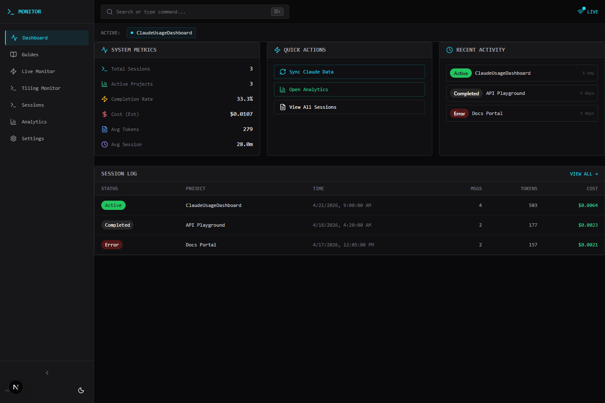
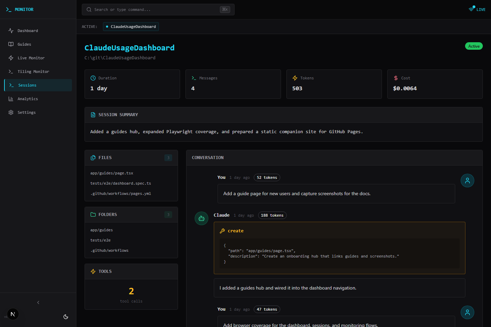
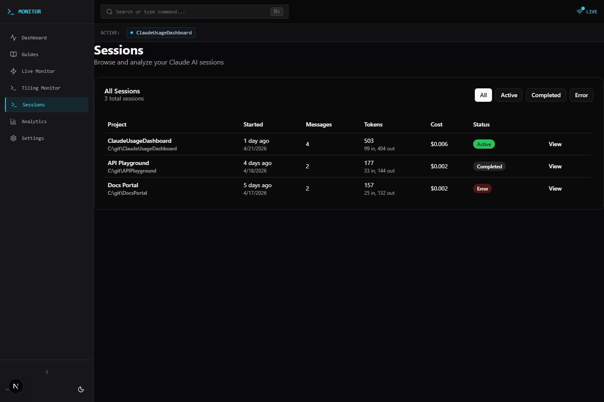
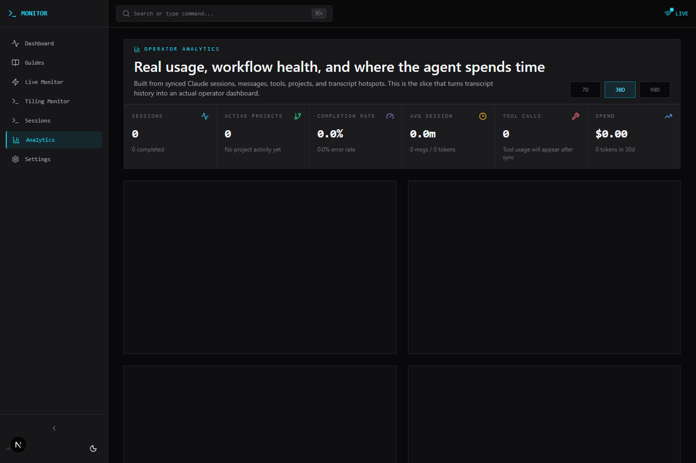
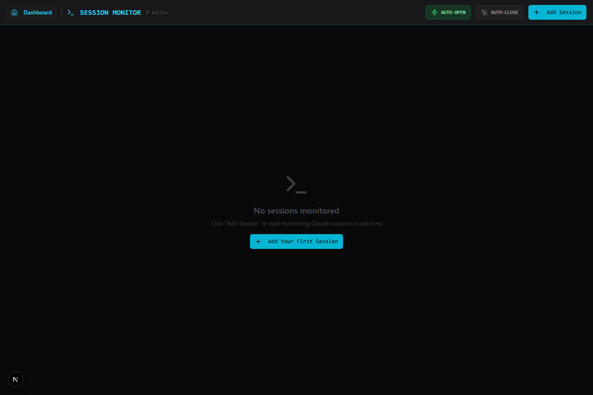
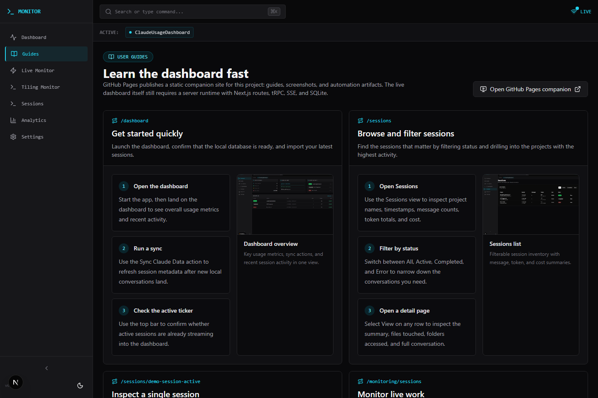

# Screenshots

The current product screenshots are generated from the seeded Playwright environment with:

```bash
npm run screenshots
```

## Dashboard Overview


_System metrics, quick actions, and recent activity on the main dashboard_

## Session Details


_Detailed statistics, summary, files, folders, and message timeline for a single session_

## Sessions List


_Filterable inventory of active, completed, and error sessions_

## Analytics Overview


_Operator analytics for completion rate, tool usage, project activity, and transcript hotspots_

## Tiling Window Manager


_Monitor active Claude sessions in a terminal-style tiling layout_

## Guides Hub


_Built-in onboarding page that links routes, workflows, and screenshots_

---

For workflow walkthroughs that use these images, open `/guides` in the app or the GitHub Pages companion site.
